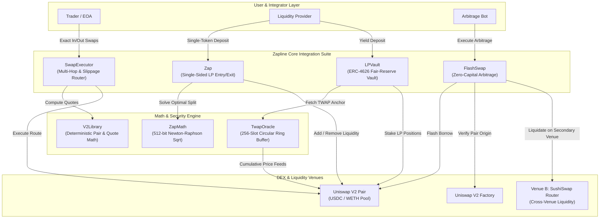
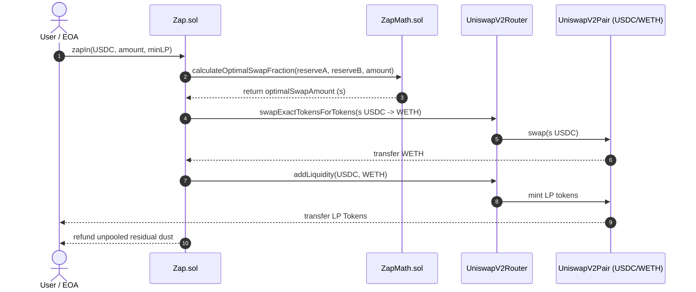
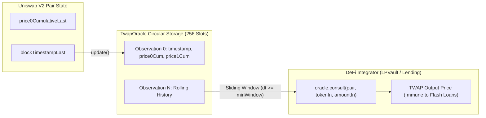
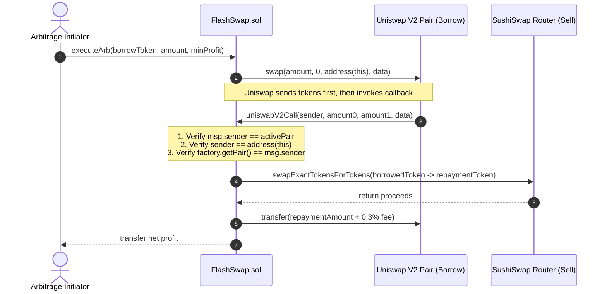

# Zapline: Uniswap V2 Integration Suite & Security Lab

> A production-grade, hardened Uniswap V2 integration suite and DeFi security research lab. Built in Solidity `0.8.24` with Foundry, fully verified against Ethereum mainnet state and live on Base Sepolia.

[](https://github.com/Jash-Bohare/Zapline/actions/workflows/test.yml)
[](https://getfoundry.sh/)
[](LICENSE)
[-blue)](https://sepolia.basescan.org)

---

## System Architecture

Zapline is an enterprise-grade protocol layer designed around Uniswap V2. It encapsulates optimized routing, automated single-sided liquidity provisioning, tamper-resistant time-weighted oracles, fair-value yield vaults, and MEV-resistant flash swap arbitrage.



---

## Core Protocol Architecture

### 1. `SwapExecutor.sol` — Hardened Multi-Hop Execution Router
[`src/SwapExecutor.sol`](src/SwapExecutor.sol) is a gas-efficient router supporting chained token trades across arbitrary paths:
- **Dual Execution Modes**:
  - `swapExactTokensForTokens`: Guarantees a minimum output (`amountOutMin`) for a fixed input.
  - `swapTokensForExactTokens`: Guarantees a maximum cost (`amountInMax`) to acquire an exact output.
- **Mathematical Pre-Validation**: Every route is verified against [`V2Library.sol`](src/libraries/V2Library.sol) before dispatching transfers, ensuring the AMM reserves match off-chain expectations.
- **Strict Slippage & Deadline Enforcement**: Guards against delayed inclusion and MEV block-stuffing.
- **Native ETH Integration**: Seamlessly handles native ETH wrap/unwrap flows (`swapExactETHForTokens`, `swapTokensForExactETH`).
- **Non-Standard ERC-20 Support**: Uses OpenZeppelin's `SafeERC20` with `forceApprove` to handle tokens that do not return a boolean or require allowance resets to zero (e.g., USDT).
- **Zero-Dust Invariant**: Automatically refunds unspent input tokens when exact-output routes require less than the pre-approved maximum.

---

### 2. `Zap.sol` & `ZapMath.sol` — Single-Sided Liquidity Provisioning
Normally, Uniswap V2 requires liquidity providers to deposit an exact 50/50 ratio of both pool assets. [`src/Zap.sol`](src/Zap.sol) enables users to enter or exit liquidity pools with a **single asset** or **native ETH** in one atomic transaction.



#### Closed-Form Mathematical Optimization
To avoid trial-and-error or brute-force iterations, [`src/libraries/ZapMath.sol`](src/libraries/ZapMath.sol) derives the exact swap fraction $s$ by solving the quadratic equation created by the 0.3% swap fee and constant-product invariant:

$$s = \frac{-b + \sqrt{b^2 - 4ac}}{2c}$$

- **512-Bit Safe Arithmetic**: Pool products ($b^2 - 4ac$) easily exceed the standard 256-bit limit for large pools. `ZapMath` implements a **512-bit safe integer Newton-Raphson square root algorithm** that guarantees zero overflow and exact precision.
- **Full Exit Support (`zapOut`, `zapOutETH`)**: Burns LP tokens, swaps the secondary asset into the desired output token, and delivers 100% of the proceeds in a single currency.

---

### 3. `TwapOracle.sol` — Sliding-Window Price Accumulator
[`src/oracle/TwapOracle.sol`](src/oracle/TwapOracle.sol) is an on-chain oracle that consumes Uniswap V2's cumulative price accumulators (`price0CumulativeLast`, `price1CumulativeLast`) to produce manipulation-resistant prices.



- **256-Slot Circular Ring Buffer**: Efficiently stores rolling timestamped price accumulators with minimal storage overhead.
- **Configurable Cadence**:
  - `minSpacing` (default 10 minutes): Rejects redundant observations within the same window to optimize gas.
  - `minWindow` (default 30 minutes): Ensures all price consultations average across a statistically significant timespan.
  - `maxAge` (default 24 hours): Reverts if the observation data is stale.
- **Flash Loan Immunity**: Because cumulative values represent the integral of price over time ($\sum P \cdot \Delta t$), instantaneous reserve manipulation within a single block has zero impact on the recorded TWAP.

---

### 4. `LPVault.sol` — Fair-Reserve ERC-4626 Yield Vault
[`src/LPVault.sol`](src/LPVault.sol) is an ERC-4626 compliant vault that accepts deposits in either single-sided assets (via `Zap`) or raw Uniswap V2 LP tokens.

#### Fair-Reserve Valuation Formula
Naive vaults evaluate total assets by multiplying LP tokens by the spot price of pool reserves, making them vulnerable to sandwich attacks. `LPVault` utilizes the **fair-reserve invariant pricing model**:

$$\text{totalAssets} = 2 \times \sqrt{r_0 \times r_1 \times P_{\text{TWAP}}} \times \frac{\text{vaultLP}}{\text{totalLPSupply}} + \text{idleAsset}$$

Where $P_{\text{TWAP}}$ is supplied directly by `TwapOracle.sol`. This ensures that depositing or withdrawing during a flash loan attack yields zero exploit profit.

#### Virtual Share Offset Protection
To eliminate the classic **ERC-4626 First-Depositor Inflation Attack**, `LPVault` overrides `_decimalsOffset()`:
```solidity
function _decimalsOffset() internal view virtual override returns (uint8) {
    return 6;
}
```
This introduces $10^6$ virtual shares and $1$ virtual asset into the share conversion math, making donation attacks economically unviable.

---

### 5. `FlashSwap.sol` — Cross-Venue Atomic Arbitrage
[`src/FlashSwap.sol`](src/FlashSwap.sol) executes zero-capital spatial arbitrage between Uniswap V2 (the lending pair) and a secondary exchange (SushiSwap / Venue B).



#### Triple-Lock Authentication Checklist
To prevent the catastrophic callback-drain vulnerabilities common in DeFi:
1. `msg.sender == _activePair`: Verifies the caller is the exact pair contract designated during initialization.
2. `sender == address(this)`: Confirms that this contract initiated the flash swap, preventing external attackers from pointing real pair callbacks at the contract.
3. `factory.getPair(token0, token1) == msg.sender`: Verifies the pair is an authentic pool deployed by the official Uniswap factory.

---

## Security Lab: Attack Proofs-of-Concept & Defenses

The repository includes a dedicated test lab (`test/attacks/`) demonstrating four critical AMM attack vectors, accompanied by automated proofs-of-concept:

### Attack 1: Spot Oracle Price Manipulation
- **Exploit**: A lending protocol calculates collateral value directly from `pair.getReserves()`. An attacker borrows 5,000,000 USDC via flash loan, dumps it into the pool to artificially inflate WETH's spot price by 300%, deposits WETH as collateral, borrows the lending protocol's entire treasury, and leaves bad debt behind.
- **Defense**: [`TwapOracle.sol`](src/oracle/TwapOracle.sol) enforces a 30-minute cumulative time-weighted average price. Single-block balance distortions have virtually zero impact on the resulting valuation.
- **Test**: `forge test --match-contract SpotOracleManipulationTest -vv`

### Attack 2: MEV Sandwich Attack on Zero Slippage
- **Exploit**: An end-user submits a trade with `amountOutMin = 0`. An MEV searcher detects the transaction in the mempool, front-runs with a large buy order to push the price up, allows the victim's trade to execute at terrible rates, and immediately back-runs by selling for risk-free profit.
- **Defense**: [`SwapExecutor.sol`](src/SwapExecutor.sol) performs strict output bounds checks calculated from canonical `V2Library` formulas.
- **Test**: `forge test --match-contract SandwichNoSlippageTest -vv`

### Attack 3: Unauthenticated Flash-Swap Callback Drain
- **Exploit**: A contract implements `uniswapV2Call` but trusts arbitrary calldata for transfer instructions. An attacker directly calls `uniswapV2Call` or triggers a real flash swap specifying the target contract as recipient, draining all treasury funds.
- **Defense**: [`FlashSwap.sol`](src/FlashSwap.sol) validates `msg.sender`, `sender`, and factory deployment origin before executing trades.
- **Test**: `forge test --match-contract UnsafeFlashCallbackTest -vv`

### Attack 4: Vault First-Depositor Inflation
- **Exploit**: An attacker deposits 1 wei of assets into a new ERC-4626 vault, minting 1 share. They then donate 100 LP tokens directly to the vault. A subsequent depositor depositing 50 LP tokens calculates $\text{shares} = 50 \times 1 / 100 = 0$ (rounded down to zero). The victim receives 0 shares, losing their entire deposit.
- **Defense**: [`LPVault.sol`](src/LPVault.sol) implements OpenZeppelin's virtual decimal offset (`_decimalsOffset() = 6`), making share inflation economically impossible.
- **Test**: `forge test --match-contract VaultInflationAttackTest -vv`

---

## Live Deployments (Base Sepolia - Chain ID: 84532)

All Zapline contracts are deployed live and verified with 100% exact match source code and ABI on **BaseScan**:

| Contract | Deployed Address | BaseScan Explorer |
| :--- | :--- | :---: |
| **`SwapExecutor`** | `0x3b9822F6a5a85b02A484946466E4c10AE8DdB46b` | [Verified Contract on BaseScan](https://sepolia.basescan.org/address/0x3b9822F6a5a85b02A484946466E4c10AE8DdB46b#code) |
| **`Zap`** | `0xe0C3452F0eECaBD975Bc770dF83b1bDeFf6bfC19` | [Verified Contract on BaseScan](https://sepolia.basescan.org/address/0xe0C3452F0eECaBD975Bc770dF83b1bDeFf6bfC19#code) |
| **`TwapOracle`** | `0x83Ba06204136b0df38a2906673364600f0B0b7D0` | [Verified Contract on BaseScan](https://sepolia.basescan.org/address/0x83Ba06204136b0df38a2906673364600f0B0b7D0#code) |
| **`LPVault`** (USDC/WETH) | `0x89EC41722e401cE1dFBE459644f68a3d7180AcA6` | [Verified Contract on BaseScan](https://sepolia.basescan.org/address/0x89EC41722e401cE1dFBE459644f68a3d7180AcA6#code) |
| **`FlashSwap`** | `0x867741F11BC22dc9d898c1c8998B4D8721384536` | [Verified Contract on BaseScan](https://sepolia.basescan.org/address/0x867741F11BC22dc9d898c1c8998B4D8721384536#code) |
| **`UniswapV2Router02`** | `0xdEb6081F07acbcB5120E2D0a4225A0e30A19543e` | [Verified Contract on BaseScan](https://sepolia.basescan.org/address/0xdEb6081F07acbcB5120E2D0a4225A0e30A19543e#code) |
| **`SushiRouter` (Venue B)** | `0x5540ac46a74D2C1c055428cc83E0f4C165b52aad` | [Verified Contract on BaseScan](https://sepolia.basescan.org/address/0x5540ac46a74D2C1c055428cc83E0f4C165b52aad#code) |

---

## Testing & Quality Assurance

Zapline includes **109 passing automated tests** with extensive coverage across unit, fuzz, invariant, and security attack suites.

```bash
# Run all tests
forge test

# Run stateful invariant fuzzing
forge test --match-contract VaultInvariantsTest

# Run all attack simulations
forge test --match-path "test/attacks/*" -vv

# Check code formatting (enforced in CI)
forge fmt --check

# Generate test coverage report
forge coverage --report summary --no-match-coverage "(test|script|mocks|periphery)"
```

### Test Suite Results

| Suite | Category | Tests | Status |
| :--- | :--- | :---: | :---: |
| `V2Refresher.t.sol` | Core AMM Mechanics | 9 | PASS |
| `SwapExecutor.t.sol` | Multi-Hop Routing & Slippage | 17 | PASS |
| `Zap.t.sol` | Single-Sided LP Entry/Exit | 17 | PASS |
| `TwapOracle.t.sol` | Sliding-Window TWAP | 10 | PASS |
| `LPVault.t.sol` | ERC-4626 Fair Valuation | 13 | PASS |
| `FlashSwap.t.sol` | Cross-Venue Arbitrage | 13 | PASS |
| `ComprehensiveCoverage.t.sol` | Edge Cases & Boundary Conditions | 19 | PASS |
| `01_SpotOracleManipulation.t.sol` | Attack PoC: Spot Price Manipulation | 2 | PASS |
| `02_SandwichNoSlippage.t.sol` | Attack PoC: MEV Sandwich | 2 | PASS |
| `03_UnsafeFlashCallback.t.sol` | Attack PoC: Callback Hijack | 4 | PASS |
| `04_VaultInflation.t.sol` | Attack PoC: Share Inflation | 2 | PASS |
| `VaultInvariants.t.sol` | Stateful Invariant Handlers | 4 | PASS |
| **Total** | **12 Test Suites** | **109 Tests** | **100% PASS** |

---

## License
MIT License. Created for decentralized finance builders and security researchers.
